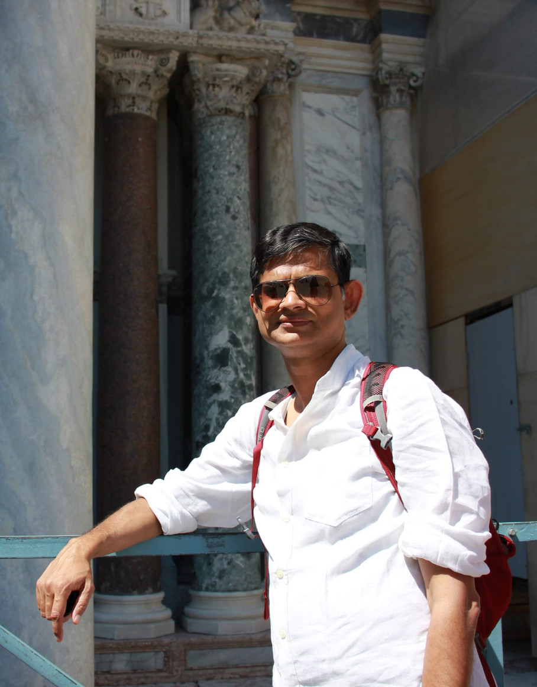

```{=html}

```

::: {.lead}
I'm an economist and an educator, based in India — and I've spent my career chasing two questions that shape a country's future: how economies grow, and how we build the institutions that carry them.
:::

Today I'm **Dean of Academics** at Shiv Nadar University, Delhi-NCR, and a **Professor in the Department of Economics**. My research sits in macroeconomics, international economics, and the questions facing emerging economies. I also write and speak for a wider public — **50+ op-eds** in *Mint*, *The Economic Times*, *The Hindu BusinessLine*, *Financial Express*, and *Times of India*, and regular commentary on **BBC World News, CNBC-TV18, Zee Business**, and **Korean Radio TBS**. In 2026 I received the **ET Education Excellence Gold Award for Transformational Academic Leadership** — recognition I happily share with my colleagues and students.

```{=html}
<div class="stat-cards">
  <div class="stat-figure c-blue"><div class="n">Ph.D.</div><div class="l">Economics, University of Minnesota</div></div>
  <div class="stat-figure c-coral"><div class="n">50+</div><div class="l">op-eds in India's leading publications</div></div>
  <div class="stat-figure c-teal"><div class="n">2026</div><div class="l">ET Education Excellence Gold Award</div></div>
</div>
```

## The long way round

I didn't set out to be an economist. I began in physics — a B.Sc. and then an M.Sc. at Jadavpur University in Kolkata — and I loved the discipline of it: the search for a few simple forces beneath a messy world. Economics drew me all at once at IGIDR, and carried me to a Ph.D. at the University of Minnesota.

```{=html}
<figure class="media-figure portrait">
  
  <figcaption>Still curious, still traveling — somewhere between a lecture and the next question.</figcaption>
</figure>
```

From the ice laden fields of US Upper Midwest, I landed in the humid tropics in Singapore when I joined the NUS Business School as a faculty member. For several years there, I got to be part of one of the best business schools and also got a chance to explore Southeast Asia. When I returned to India, I was handed a rare opportunity: to build a university department from a blank page. As **founding Head of the Department of Economics** at Shiv Nadar University (2013–2022), I recruited a faculty I'm proud of, shaped its research culture, and grew its **B.Sc. (Research), M.Sc., and Ph.D.** programs into some of the most sought-after in the country — later adding the multidisciplinary **B.Sc. (Research) in Economics & Finance**.

As the inaugural **Dean for International Partnerships**, I set up the university's global engagement. I led a **€1.17M EU-funded** higher-education project, and the **Beyond Boundaries** series. In 2020 I founded the annual **SNU Macroeconomics Conference** to bring India's macro community together. Since 2023, as **Dean of Academics**, I've led academic strategy across the university. I have also continued my interest in global engagement with the launch of **2+2 dual degrees with Arizona State University**. (There's more on the [Higher Education](higher-education.html) page.)

Somewhere along the way, the two halves of my work — the economics and the institution-building — stopped feeling separate. Both are really about the same thing: how ideas, and the institutions that carry them, grow together.

## Education

| Degree | Field | Institution | Year |
|---|---|---|---|
| Ph.D. | Economics | University of Minnesota | 2005 |
| M.Phil. | Economics | Indira Gandhi Institute of Development Research (IGIDR), Mumbai | 1999 |
| M.Sc. | Physics | Jadavpur University | 1996 |
| B.Sc. | Physics | Jadavpur University | 1994 |

## Positions

```{=html}
<div class="timeline">
  <div class="tl-item c-blue"><div class="tl-when">2023 – present</div><div class="tl-what"><strong>Dean of Academics</strong>, Shiv Nadar University</div></div>
  <div class="tl-item c-teal"><div class="tl-when">2019 – present</div><div class="tl-what"><strong>Professor</strong>, Department of Economics, Shiv Nadar University</div></div>
  <div class="tl-item c-coral"><div class="tl-when">2019 – 2021</div><div class="tl-what"><strong>Dean for International Partnerships</strong> (inaugural), Shiv Nadar University</div></div>
  <div class="tl-item c-blue"><div class="tl-when">2013 – 2022</div><div class="tl-what"><strong>Founding Head</strong>, Department of Economics, Shiv Nadar University</div></div>
  <div class="tl-item c-teal"><div class="tl-when">2011 – 2013</div><div class="tl-what">Assistant Professor, <strong>FMS, University of Delhi</strong></div></div>
  <div class="tl-item c-coral"><div class="tl-when">2005 – 2011</div><div class="tl-what">Assistant Professor, <strong>NUS Business School</strong>, Singapore</div></div>
</div>
```


## Bio for introductions

Ready-made bios for chairs and organisers — read them out or paste them in. Two lengths; use whichever fits.

```{=html}
<style>
.bio-block{background:#fbf4e6;border:1px solid #e7dcc8;border-radius:14px;padding:1.1rem 1.3rem;margin:1rem 0;}
.bio-head{display:flex;justify-content:space-between;align-items:center;gap:1rem;margin-bottom:.55rem;}
.bio-head .bio-kind{font-size:.72rem;letter-spacing:.08em;text-transform:uppercase;color:#6f6a62;font-weight:700;}
.bio-copy{background:#6d54b5;color:#fff;border:none;border-radius:999px;padding:.32rem .95rem;font-size:.8rem;font-weight:600;cursor:pointer;transition:background .15s ease;white-space:nowrap;}
.bio-copy:hover{background:#573f9c;}
.bio-text{margin:0;line-height:1.6;color:#2c2620;}
</style>

<div class="bio-block">
  <div class="bio-head"><span class="bio-kind">Short &middot; ~60 words</span><button class="bio-copy" onclick="copyBio(this)">Copy</button></div>
  <p class="bio-text">Partha Chatterjee is Dean of Academics and Professor of Economics at Shiv Nadar Institution of Eminence. A macroeconomist trained at the University of Minnesota, he works on growth, emerging economies, and India's labor market, and writes and speaks widely on the economy and higher education. In 2026 he received the ET Education Excellence Gold Award for Transformational Academic Leadership.</p>
</div>

<div class="bio-block">
  <div class="bio-head"><span class="bio-kind">Full &middot; ~160 words</span><button class="bio-copy" onclick="copyBio(this)">Copy</button></div>
  <p class="bio-text">Partha Chatterjee is Dean of Academics and Professor of Economics at Shiv Nadar Institution of Eminence, where he leads academic strategy across the university. A macroeconomist who works with data and dynamic models, his research spans macroeconomics, international economics, and the structural questions facing emerging economies, with a particular focus on India &mdash; from growth and productivity to trade, monetary policy, and the labor market. He earned his Ph.D. in Economics from the University of Minnesota, and taught at the National University of Singapore Business School and the University of Delhi before helping build Shiv Nadar University from its inception &mdash; as founding Head of the Department of Economics and its first Dean for International Partnerships. He writes and speaks widely for a general audience, with op-eds in India's leading publications and commentary on the BBC and CNBC-TV18. In 2026 he received the ET Education Excellence Gold Award for Transformational Academic Leadership.</p>
</div>

<script>
function copyBio(btn){
  var t = btn.closest('.bio-block').querySelector('.bio-text').innerText;
  navigator.clipboard.writeText(t).then(function(){
    var o = btn.textContent; btn.textContent = 'Copied ✓';
    setTimeout(function(){ btn.textContent = o; }, 1600);
  });
}
</script>
```
