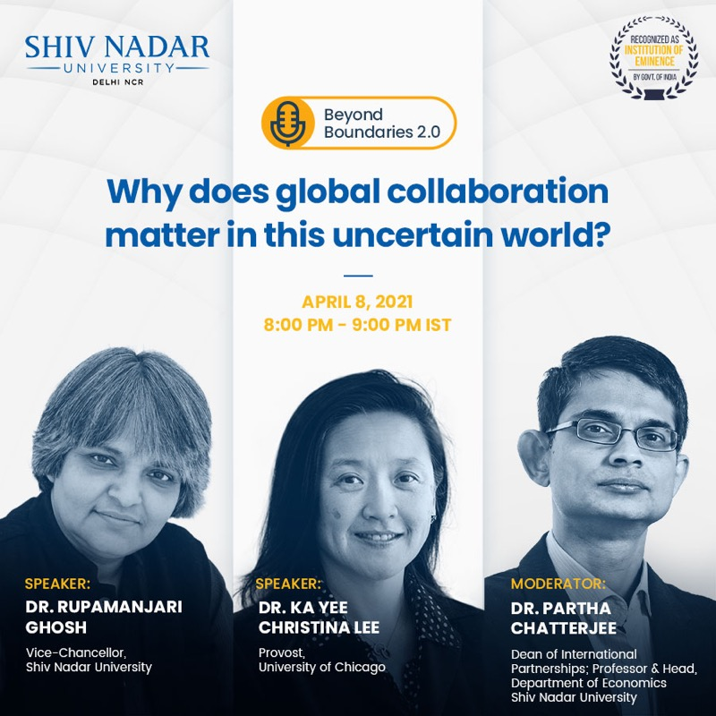
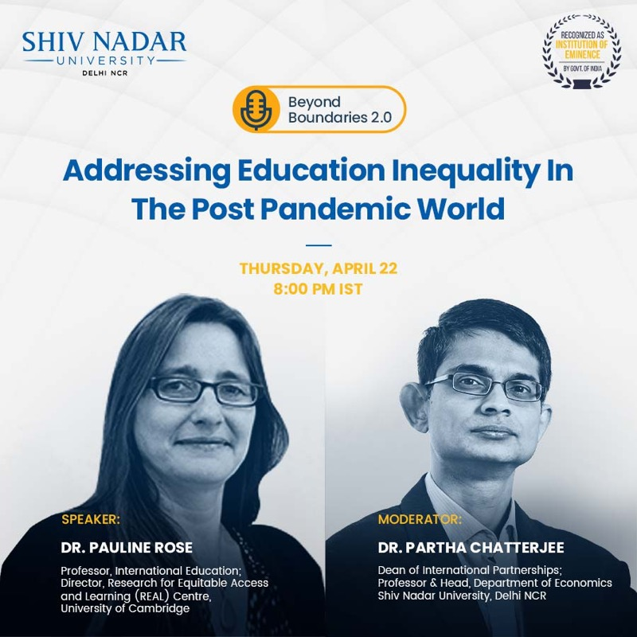
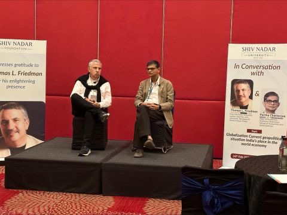
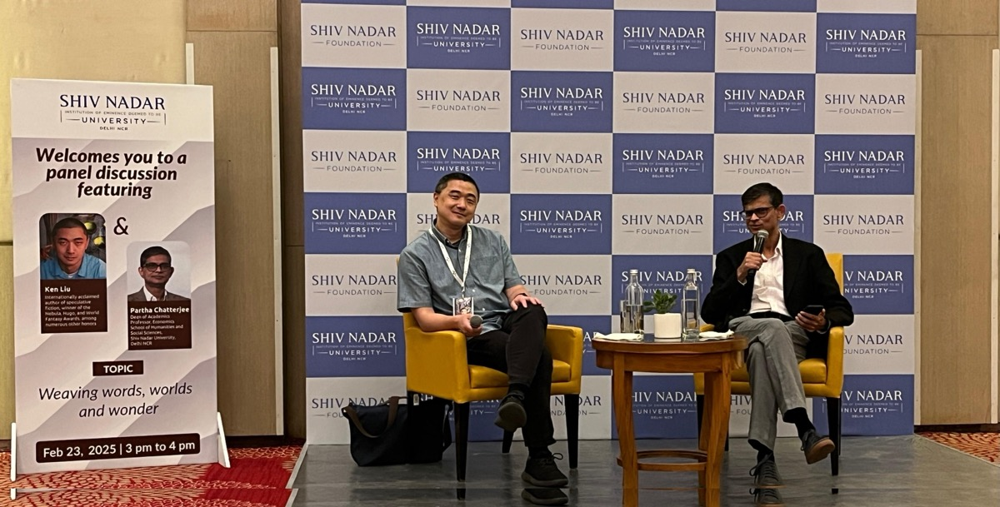
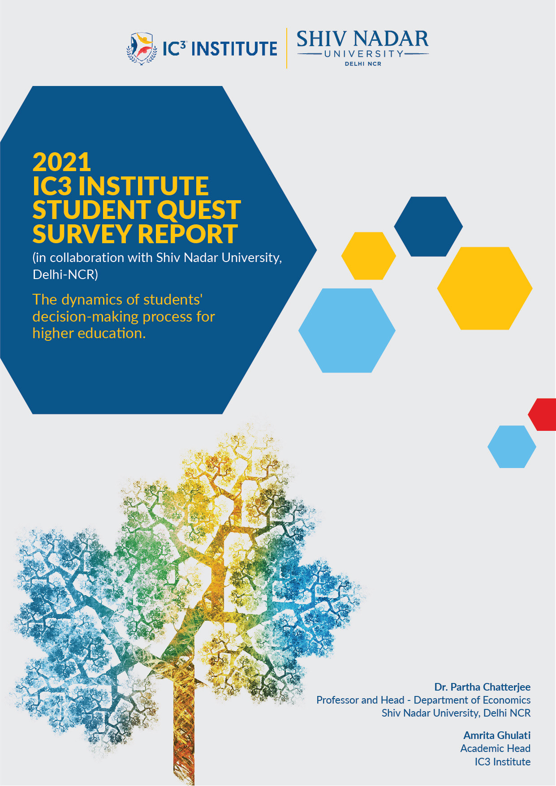
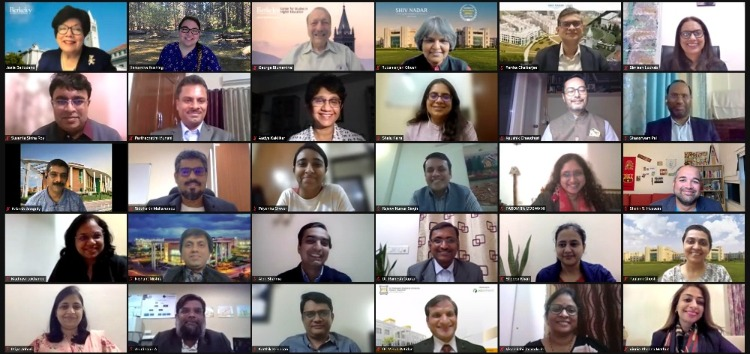

::: {.lead}
The second engine of a nation's progress is its institutions of learning. I have spent much of my career **building them** — a department, degree programs, and international partnerships from inception — and **shaping the wider conversation** about what higher education in India should become.
:::

```{=html}
<div class="stat-cards">
  <div class="stat-figure c-blue"><div class="n">Founding</div><div class="l">faculty member, Shiv Nadar University</div></div>
  <div class="stat-figure c-teal"><div class="n">2013–22</div><div class="l">founding Head, Department of Economics</div></div>
  <div class="stat-figure c-coral"><div class="n">6,000+</div><div class="l">students surveyed across South Asia (Student Quest)</div></div>
  <div class="stat-figure c-blue"><div class="n">Dean</div><div class="l">of Academics since 2023</div></div>
</div>
```

## Building an institution

I have been part of building Shiv Nadar University from its inception. As **founding Head of the Department of Economics** (2013–2022), I recruited a world-class faculty, shaped the department's research culture, and built its **B.Sc. (Research), M.Sc., and Ph.D.** programs into some of the most sought-after in the country. I went on to conceive its multidisciplinary **B.Sc. (Research) in Economics & Finance**.

Today, as **Dean of Academics** — the university's chief academic officer since 2023 — I lead academic strategy across the institution: new programs, curriculum, and academic policy. Recent work includes launching the **B.A. (Research) in Interdisciplinary Humanities and Social Sciences** (2025) and a pioneering, **graded policy for the use of generative AI** in teaching and learning, adopted university-wide.

### International partnerships

As the inaugural **Dean for International Partnerships**, I set up the university's global-engagement office and strategy. That work includes:

- **2+2 dual degrees with Arizona State University** — a STEM-designated **B.S. in Business Data Analytics** (the first of its kind in India) and a **B.S. in Computer Science**, with students spending two years at SNU and two at ASU's W. P. Carey School.
- A **€1.17M EU-funded project** on higher-education quality enhancement.

```{=html}
<div class="badges">
  <span class="badge-chip">Arizona State University</span>
  <span class="badge-chip">UC Berkeley — CSHE</span>
  <span class="badge-chip">IC3 Institute</span>
  <span class="badge-chip">European Union</span>
</div>
```

### Beyond Boundaries — global conversations

During the pandemic, as Dean for International Partnerships, I conceived and hosted **Beyond Boundaries**, a public dialogue series that brought leading voices in academia and policy to a wide online audience, on the economy, education, and global collaboration in an uncertain world. Interlocutors included the **Provost of the University of Chicago**, a **Cambridge** professor of international education, chancellors from **UC Berkeley** and **Vanderbilt**, and the economist **V. V. Chari** (University of Minnesota), with audiences joining from more than 20 countries.

```{=html}
<div class="photo-row">
  <figure>
    
    <figcaption>Beyond Boundaries 2.0 — with the Provost of the University of Chicago, on why global collaboration matters in an uncertain world.</figcaption>
  </figure>
  <figure>
    
    <figcaption>Beyond Boundaries 2.0 — with a Cambridge professor of international education, on education inequality in the post-pandemic world.</figcaption>
  </figure>
</div>
```

### In conversation with global thinkers

Through the university's flagship **Synapse Conclave**, I have hosted public conversations that bring global thinkers into dialogue with our students. In 2024 I spoke with **Thomas L. Friedman** on globalization, geopolitics, and India's place in the world economy; in 2025, with the award-winning author **Ken Liu** on storytelling, technology, imagination, and AI.

```{=html}
<div class="photo-row photos">
  <figure>
    
    <figcaption>In conversation with Thomas L. Friedman — Synapse Conclave, 2024.</figcaption>
  </figure>
  <figure>
    
    <figcaption>In conversation with Ken Liu — Synapse Conclave, 2025.</figcaption>
  </figure>
</div>
```

### Convening the field

In 2020 I founded the **Shiv Nadar University Macroeconomics Conference** — begun online during the pandemic and now an annual in-person gathering in its fifth edition. It has grown into a platform that connects India's macroeconomics community with peers worldwide and sharpens their research.

### A timeline of building

```{=html}
<div class="timeline">
  <div class="tl-item c-blue"><div class="tl-when">2013</div><div class="tl-what">Founding Head, <strong>Department of Economics</strong></div></div>
  <div class="tl-item c-teal"><div class="tl-when">2019</div><div class="tl-what">Inaugural <strong>Dean for International Partnerships</strong></div></div>
  <div class="tl-item c-coral"><div class="tl-when">2020</div><div class="tl-what">Founded the <strong>SNU Macroeconomics Conference</strong></div></div>
  <div class="tl-item c-blue"><div class="tl-when">2021</div><div class="tl-what">CSHE–Berkeley <strong>Executive Leadership Academy</strong>; IC3 <strong>Student Quest</strong></div></div>
  <div class="tl-item c-teal"><div class="tl-when">2023</div><div class="tl-what">Appointed <strong>Dean of Academics</strong></div></div>
  <div class="tl-item c-coral"><div class="tl-when">2024</div><div class="tl-what"><strong>Arizona State University</strong> 2+2 dual degrees launched</div></div>
  <div class="tl-item c-blue"><div class="tl-when">2025</div><div class="tl-what"><strong>B.A. (Research) in IHS</strong>; university-wide <strong>GenAI policy</strong></div></div>
  <div class="tl-item c-teal"><div class="tl-when">2026</div><div class="tl-what"><strong>ET Education Excellence Gold Award</strong> — Transformational Academic Leadership</div></div>
</div>
```

## Shaping higher education in India

### Student Quest: how students choose

```{=html}
<figure class="figure-right">
  <a href="https://ic3institute.org/wp-content/uploads/2021/09/2021-IC3-Institute-Student-Quest-in-collaboration-SNU.pdf" target="_blank" rel="noopener"></a>
  <figcaption>2021 IC3 Student Quest Report</figcaption>
</figure>
```

The **2021 IC3 Student Quest Report** examines how high-school students choose their college, course, city, and country — who influences those choices and where they find information. It draws on responses from over **6,000 high-school students across more than 2,000 schools** in India and South Asia, in collaboration with the IC3 Institute.

- [Read the 2021 IC3 Student Quest Report (PDF)](https://ic3institute.org/wp-content/uploads/2021/09/2021-IC3-Institute-Student-Quest-in-collaboration-SNU.pdf) · *Covered by NDTV and others.*

### Executive Leadership Academy — CSHE Berkeley × Shiv Nadar University

The **1st International Executive Leadership Academy**, conducted by the Center for Studies in Higher Education (CSHE), UC Berkeley, in collaboration with Shiv Nadar University, was held in November 2021. It addresses the transformation of the higher-education sector and the leadership it demands. I initiated the conversations with CSHE, led the India launch, and taught within the program.

- [About the CSHE Executive Leadership Academy](https://cshe.berkeley.edu/ela)

```{=html}
<figure class="media-figure">
  
  <figcaption>Academic leaders convening for the CSHE–Berkeley × Shiv Nadar University Executive Leadership Academy.</figcaption>
</figure>
```

### On the National Education Policy

**New Education Policy gives pride of place to research in universities** — *The Hindu BusinessLine.* A central recommendation of the NEP — a sharp departure from the policy followed since Independence — is that it brings research back to the universities. (More under [Commentary](writing.html).)

## Teaching

I have taught across the graduate, MBA, and undergraduate levels at Shiv Nadar University (SNU), the National University of Singapore (NUS), FMS, University of Delhi, and the University of Minnesota.

**Graduate (SNU):** Macroeconomics I · Macroeconomics II · Computational Economics · International Trade

**MBA (SNU, FMS, NUS):** Macroeconomics · Macro and International Economics · International Business Environment · Economic Environment of Business · Managerial Economics

**Undergraduate (SNU, NUS, Minnesota):** Advanced Macroeconomics · Intermediate Macroeconomics · Intermediate Microeconomics · Growth and Inequality · Development Economics · Financial Economics · Asia-Pacific Business and Society
