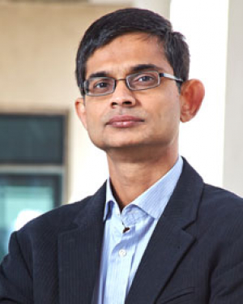

```{=html}
<!-- ===================== HERO ===================== -->
<section class="hero-band">
  <div class="wrap hero">
    <div class="hero-text">
      <h1 class="reveal">Partha Chatterjee</h1>
      <p class="lead reveal d1">I'm an economist and an educator. What keeps me excited? If I had to crystallize it into one question: how do economies grow, and how do we build the institutions that carry them forward? Today I'm Dean of Academics and Professor of Economics at Shiv Nadar University, and I write and speak widely on the economy and the future of education.</p>
      <div class="btn-row reveal d2">
        <a class="btn-primary-cta" href="about.html">More about me</a>
        <a class="btn-ghost-cta" href="contact.html">Say hello</a>
      </div>
    </div>
    <div class="hero-photo reveal d2">
      
    </div>
  </div>
</section>

<!-- ===================== THREE PILLARS ===================== -->
<section class="section">
  <div class="wrap">
    <div class="eyebrow">What I spend my time on</div>
    <h2 class="section-title">Three threads</h2>
    <p class="section-sub">Economics, institution-building, and writing. Different work, but each feeds the others — what I learn as an economist shapes how I build and what I write, and the reverse.</p>
    <div class="pillars">

      <a class="pillar-card c-blue reveal d1" href="economics.html">
        <i class="bi bi-graph-up-arrow"></i>
        <h3>The economist</h3>
        <p>Research in macroeconomics and international economics, centered on how emerging economies
        make the leap to developed ones.</p>
        <span class="more">Explore the research →</span>
      </a>

      <a class="pillar-card c-teal reveal d2" href="higher-education.html">
        <i class="bi bi-building"></i>
        <h3>The educator &amp; builder</h3>
        <p>Building a university from the ground up, leading academic strategy, and helping reshape
        higher education in India.</p>
        <span class="more">See the work →</span>
      </a>

      <a class="pillar-card c-coral reveal d3" href="writing.html">
        <i class="bi bi-megaphone"></i>
        <h3>The public voice</h3>
        <p>Writing, broadcast commentary, and talks that bring economics and education to a wider
        public — from the budget to the future of universities.</p>
        <span class="more">Read &amp; watch →</span>
      </a>

    </div>
  </div>
</section>

<!-- ===================== RECOGNITION SPOTLIGHT ===================== -->
<section class="spotlight">
  <div class="wrap spotlight-inner">
    <div class="spot-text">
      <div class="eyebrow"><i class="bi bi-award-fill"></i> Recent recognition</div>
      <h2>ET Education Excellence Gold Award <span class="spot-year">2026</span></h2>
      <p>Gold Award for <strong>Transformational Academic Leadership</strong> at The Economic Times' Education Excellence Awards.</p>
      <a class="spot-cta" href="higher-education.html">My work in education →</a>
    </div>
    <div class="spot-media">
      
    </div>
  </div>
</section>

<!-- ===================== FEATURED WRITING ===================== -->
<section class="section mint">
  <div class="wrap">
    <div class="eyebrow">Lately</div>
    <h2 class="section-title">Recent commentary</h2>
    <p class="section-sub">A little of what I've been thinking about lately.</p>
    <div class="feature-grid">

      <a class="feature-card" href="https://www.thecore.in/podcasts/indias-missing-middle-is-holding-back-prosperity-868573">
        <div class="outlet">The Core &middot; Podcast</div>
        <h4>India&rsquo;s missing middle is holding back prosperity</h4>
      </a>

      <a class="feature-card" href="https://www.fortuneindia.com/opinion/the-hedge-thats-quietly-breaking/148683">
        <div class="outlet">Fortune India</div>
        <h4>The hedge that&rsquo;s quietly breaking</h4>
      </a>

      <a class="feature-card" href="https://www.hindustantimes.com/ht-insight/future-tech/ai-makes-learning-faster-but-is-it-making-thinking-harder-101778502256696.html">
        <div class="outlet">Hindustan Times</div>
        <h4>AI makes learning faster &mdash; but is it making thinking harder?</h4>
      </a>

    </div>
    <div class="center-cta">
      <a class="btn-ghost-cta" href="writing.html">All writing &amp; talks →</a>
    </div>
  </div>
</section>

<!-- ===================== SUBTLE AVAILABILITY NOTE ===================== -->
<section class="avail-note">
  <div class="wrap">
    <p>I'm always happy to talk — whether it's a <a href="speaking.html">talk</a>, a piece of writing, an advisory conversation, or economics over coffee. <a href="contact.html">Say hello →</a></p>
  </div>
</section>

<!-- Structured data for search engines (schema.org Person). -->
<script type="application/ld+json">
{
  "@context": "https://schema.org",
  "@type": "Person",
  "name": "Partha Chatterjee",
  "jobTitle": "Dean of Academics and Professor of Economics",
  "description": "Economist and educator working on macroeconomics, international economics, how emerging economies become developed, and the building of higher-education institutions in India.",
  "url": "https://www.parthachatterjee.net",
  "affiliation": { "@type": "CollegeOrUniversity", "name": "Shiv Nadar University, Delhi-NCR" },
  "alumniOf": [
    { "@type": "CollegeOrUniversity", "name": "University of Minnesota" },
    { "@type": "CollegeOrUniversity", "name": "Indira Gandhi Institute of Development Research (IGIDR)" }
  ],
  "knowsAbout": ["Macroeconomics", "International economics", "Emerging economies", "Economic development", "Higher education policy", "Monetary policy"],
  "award": ["ET Education Excellence Gold Award 2026 — Transformational Academic Leadership"],
  "sameAs": [
    "https://www.linkedin.com/in/pchatterjee/",
    "https://x.com/p_chatterjee",
    "https://www.youtube.com/@ParthaChatterjeeS"
  ]
}
</script>
```
