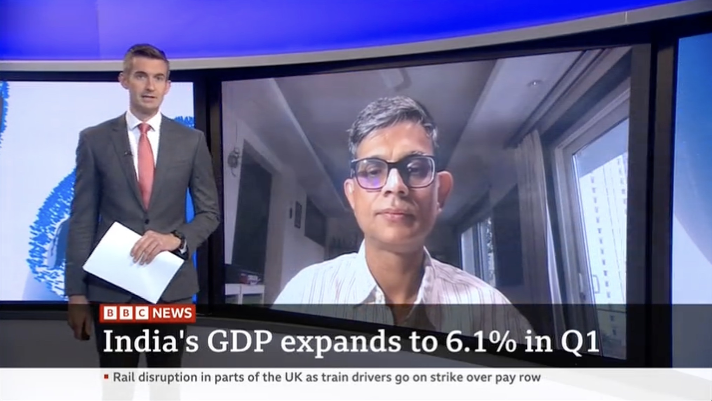

::: {.lead}
I speak to conferences, boardrooms, and campuses about the forces shaping the economy and education — translating complex trends into clear, useful ideas an audience can act on. Talks are tailored to the room, whether it's a CEO offsite, an industry summit, a policy forum, or a convocation.
:::

[Invite me to speak](mailto:partha.chatterjee@snu.edu.in?subject=Speaking%20invitation){.btn-inline} &nbsp; [Check availability](contact.html){.btn-inline-ghost}

## Topics I speak on

```{=html}
<div class="icon-cards">
  <div class="icon-card c-blue">
    <i class="bi bi-graph-up-arrow"></i>
    <h4>The Indian economy</h4>
    <p>Where it is and where it's headed — growth, inflation, jobs, the budget, and what the numbers really mean.</p>
  </div>
  <div class="icon-card c-teal">
    <i class="bi bi-rocket-takeoff"></i>
    <h4>From emerging to developed</h4>
    <p>What it takes for India and other emerging economies to make the leap — and what stands in the way.</p>
  </div>
  <div class="icon-card c-coral">
    <i class="bi bi-globe2"></i>
    <h4>The new global order</h4>
    <p>Trade wars, tariffs, and geopolitics — and how a reconfiguring world reshapes India's choices.</p>
  </div>
  <div class="icon-card c-blue">
    <i class="bi bi-mortarboard"></i>
    <h4>The future of higher education</h4>
    <p>How universities must change, and what AI means for teaching, learning, and thinking.</p>
  </div>
  <div class="icon-card c-teal">
    <i class="bi bi-people"></i>
    <h4>Work, jobs &amp; the gender gap</h4>
    <p>Why so many Indians — and most women — remain outside the labor force, and what can change it.</p>
  </div>
  <div class="icon-card c-coral">
    <i class="bi bi-compass"></i>
    <h4>Thinking about uncertainty</h4>
    <p>Making decisions, and educating the next generation, for a future we can't fully predict.</p>
  </div>
</div>
```

*Every talk is adapted to your audience and theme — tell me what you need and I'll shape it.*

## Formats

- **Keynote addresses** and plenaries
- **Fireside chats** and moderated conversations
- **Panels** — as speaker or moderator
- **Masterclasses and workshops** for leadership teams and faculty
- **Convocation and commencement** addresses

## Selected engagements

- **Keynote**, LEO Economics Conference 2026, Plaksha University
- **Plenary**, 70th-anniversary conference, BIT Mesra
- Invited talks at the **Delhi School of Economics**, **CAFRAL** (an RBI institute), and the **University of Hyderabad**
- **BW Education Summit** and the **THE Innovation & Impact Summit**
- **Global Finance Conclave**, O. P. Jindal Global University
- Attendee and commentator, **World Economic Forum, Davos** (50th Annual Meeting)
- Convener, the annual **Shiv Nadar University Macroeconomics Conference** (founded 2020)

## On air

Regular economic commentary on **BBC World News, CNBC-TV18, Zee Business**, and **Korean Radio TBS**, and podcasts including *The Hindu*'s *In Focus* and *How India's Economy Works*. A selection is on the [Writing & Commentary](writing.html#talks-broadcast) page and my [YouTube channel](https://www.youtube.com/@ParthaChatterjeeS).

```{=html}
<figure class="media-figure">
  
  <figcaption>Live on <em>BBC World News</em> on India's GDP and the state of the economy.</figcaption>
</figure>
```

---

::: {.callout-cta}
### Bring clarity to your next event
Tell me your theme, audience, and date — I'll come back quickly on fit and availability.

[Invite me to speak](mailto:partha.chatterjee@snu.edu.in?subject=Speaking%20invitation){.btn-inline} &nbsp; [Use the contact form](contact.html){.btn-inline-ghost}
:::
